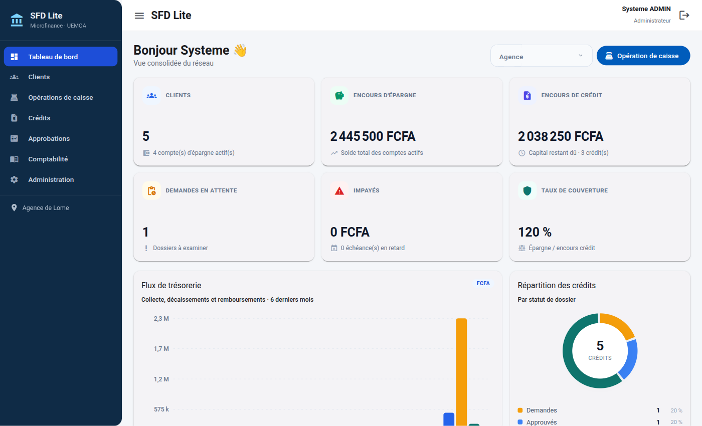
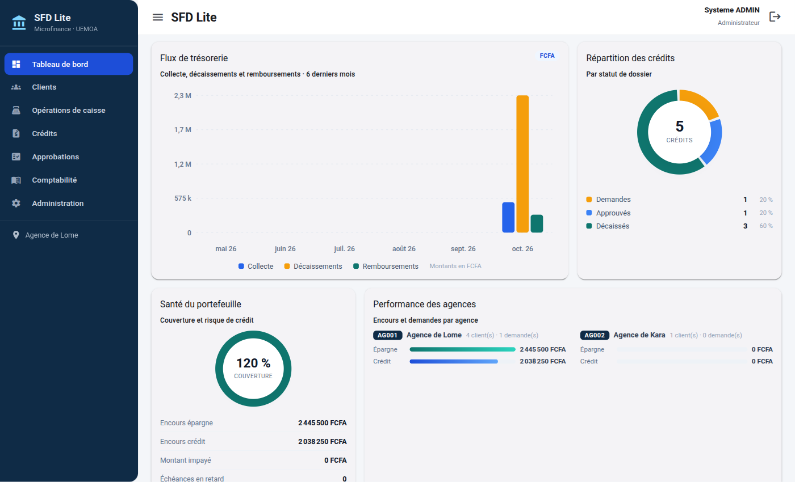
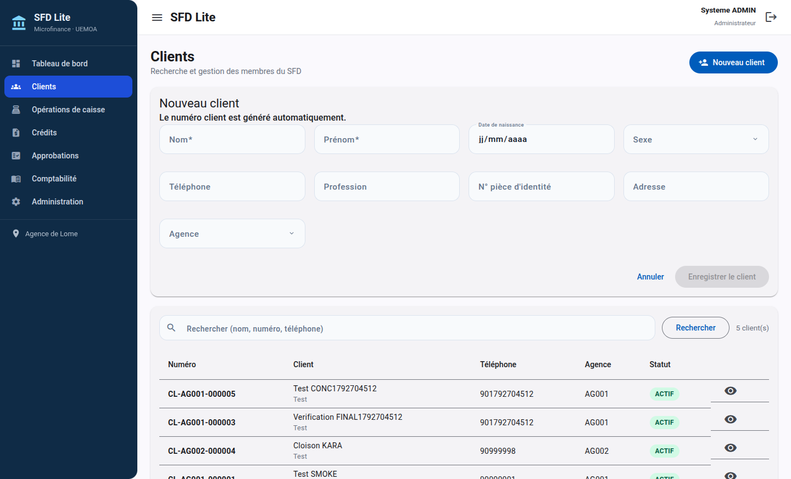
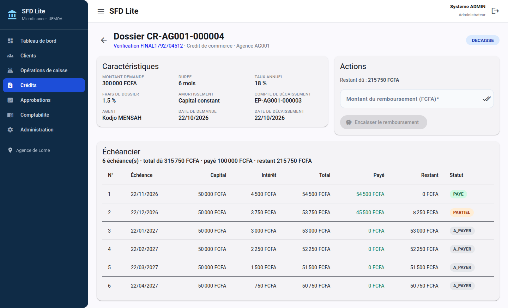
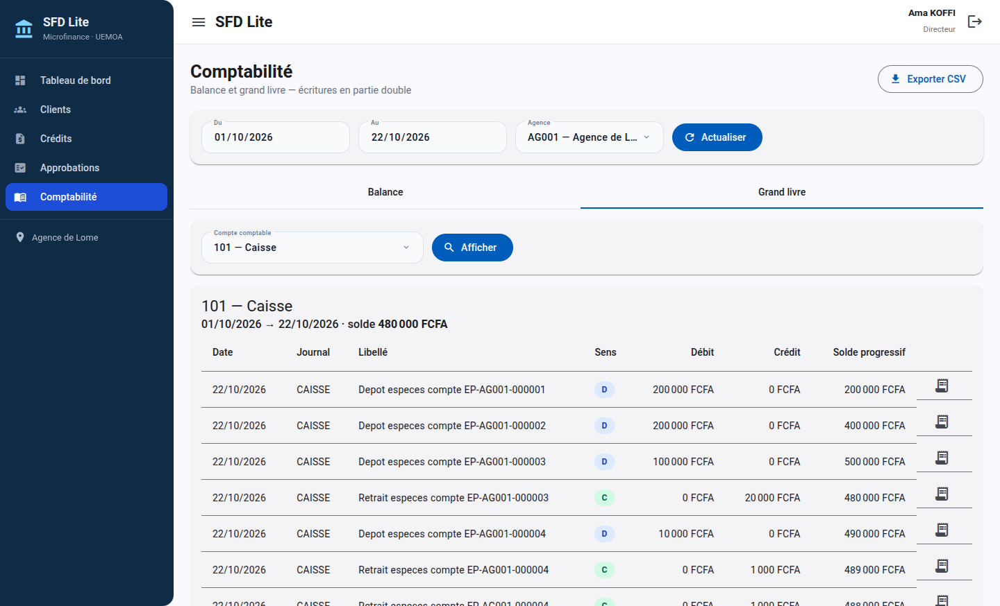
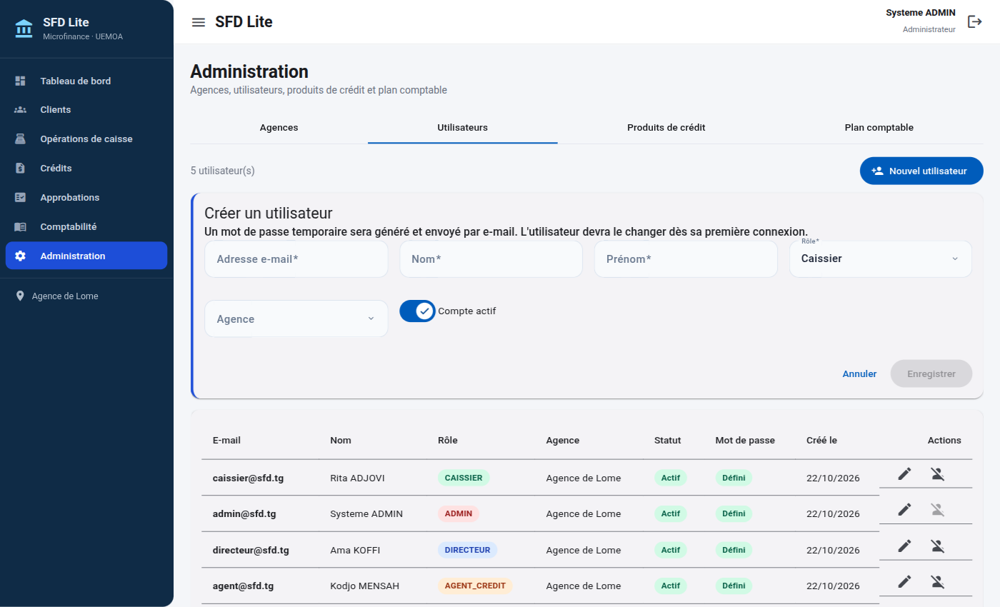

# Core Banking SFD Lite

Application de gestion pour un **Système Financier Décentralisé (SFD)** de microfinance en zone UEMOA (Togo, FCFA/XOF). Elle couvre l'épargne, le crédit, la caisse, la comptabilité en partie double et le pilotage multi-agences.

> Périmètre volontairement limité : pas de mobile money, pas de frais/intérêts d'épargne, pas de clôture annuelle, pas de rapports BCEAO, pas de groupes solidaires, pas d'import/export de masse.

## Sommaire

- [Fonctionnalités](#fonctionnalités)
- [Stack technique](#stack-technique)
- [Démarrage rapide avec Docker](#démarrage-rapide-avec-docker)
- [Démarrage local (développement)](#démarrage-local-développement)
- [Comptes de démonstration](#comptes-de-démonstration)
- [Règles métier](#règles-métier)
- [Comptabilité](#comptabilité)
- [API REST](#api-rest)
- [Tests](#tests)
- [Captures](#captures)
- [Structure du dépôt](#structure-du-dépôt)
- [Documentation](#documentation)
- [Limites et mise en production](#limites-et-mise-en-production)

## Fonctionnalités

- **Authentification & habilitations** : JWT (accès 15 min, rafraîchissement 7 jours), BCrypt, rôles `ADMIN`, `DIRECTEUR`, `AGENT_CREDIT`, `CAISSIER`, `COMPTABLE`.
- **Création de compte sécurisée** : l'administrateur ne saisit jamais le mot de passe. Un mot de passe temporaire est généré, envoyé par e-mail, puis doit être changé dès la première connexion.
- **Mon compte** : chaque utilisateur consulte ses informations (e-mail, rôle, agence, statut, date de création) et peut modifier son mot de passe à tout moment.
- **Multi-agences** : filtrage systématique par l'agence du JWT ; les rôles `ADMIN` et `DIRECTEUR` ont une vision globale.
- **Clients** : création, recherche paginée (nom, numéro, téléphone), fiche client avec comptes et crédits.
- **Épargne** : ouverture de compte, dépôt, retrait, relevé paginé, verrou pessimiste sur le solde.
- **Crédit** : produits paramétrables, demande, approbation/rejet avec séparation des tâches, décaissement, échéancier (annuité constante ou capital constant), remboursement avec imputation.
- **Comptabilité** : écritures automatiques en partie double, balance, grand livre, extourne, export CSV côté navigateur.
- **Audits** : historique des connexions et des requêtes d’écriture, accessible aux administrateurs et aux directeurs de leur agence.
- **Tableau de bord** : 6 indicateurs de pilotage (clients, épargne, crédit, demandes, impayés, couverture), flux de trésorerie sur 6 mois, répartition des crédits par statut, jauge de couverture et performance par agence.
- **Interface responsive** : barre latérale escamotable sur mobile, grilles adaptatives, formulaires et tableaux utilisables sur petits écrans (défilement horizontal des tableaux).
- **Administration** : agences, utilisateurs, produits de crédit, plan comptable.

## Stack technique

| Couche | Technologies |
| --- | --- |
| Backend | Java 21, Spring Boot 3.5, Spring Security, Spring Data JPA, Flyway, PostgreSQL 16, springdoc-openapi |
| Authentification | JJWT 0.12, BCrypt, JWT HS512 |
| E-mail | Spring Mail, SMTP ; Mailpit en local/Docker |
| Base de données | PostgreSQL 16, `NUMERIC(18,0)` pour les montants, `TIMESTAMPTZ` en UTC, `ddl-auto=validate` |
| Frontend | Angular 22, composants standalone, Signals, Angular Material, routes lazy, interceptor JWT, guards de rôle |
| Tests | JUnit 5, Mockito, Testcontainers PostgreSQL (pas de H2) |
| Conteneurs | Docker multi-stage, Docker Compose, nginx |

## Démarrage rapide avec Docker

Prérequis : Docker Engine et Docker Compose v2.

```bash
cp .env.example .env
# Modifier au minimum POSTGRES_PASSWORD et JWT_SECRET dans .env
docker compose up --build
```

| Service | URL |
| --- | --- |
| Frontend | <http://localhost:8081> |
| API | <http://localhost:8080/api> |
| Swagger UI | <http://localhost:8080/swagger-ui.html> |
| OpenAPI JSON | <http://localhost:8080/v3/api-docs> |
| Mailpit (e-mails de test) | <http://localhost:8025> |
| PostgreSQL | `localhost:5432` (port modifiable via `POSTGRES_PORT`) |

Au premier démarrage, Flyway crée le schéma (`V1`), les contraintes d'immuabilité, index et séquences (`V2`), les données de démonstration (`V3`), le flag de changement obligatoire du mot de passe (`V4`) puis les tables d'audit (`V5`). Les données PostgreSQL sont conservées dans le volume `pgdata`.

Mailpit intercepte les e-mails envoyés par le backend. Après création d'un utilisateur, ouvrir <http://localhost:8025> pour récupérer le mot de passe temporaire.

Pour arrêter et supprimer les données :

```bash
docker compose down -v
```

## Démarrage local (développement)

Prérequis : Java 21, Maven 3.9+, Node.js 22+ et npm, PostgreSQL 16.

### 1. Base de données

Le plus simple est de démarrer uniquement PostgreSQL avec Compose :

```bash
docker compose up -d postgres
```

Sinon, créer une base `sfd` et un utilisateur `sfd` sur un PostgreSQL 16 local. Le backend utilise par défaut :

```text
jdbc:postgresql://localhost:5432/sfd
utilisateur : sfd
mot de passe : sfd
```

Ces valeurs sont surchargeables par `DB_URL`, `DB_USER` et `DB_PASSWORD`.

### 2. Backend

```bash
cd backend
mvn spring-boot:run
```

Le backend écoute sur <http://localhost:8080>. Swagger est disponible sur <http://localhost:8080/swagger-ui.html>.

Configuration utile :

| Propriété / variable | Défaut | Description |
| --- | --- | --- |
| `DB_URL` | `jdbc:postgresql://localhost:5432/sfd` | URL JDBC |
| `DB_USER` | `sfd` | Utilisateur PostgreSQL |
| `DB_PASSWORD` | `sfd` | Mot de passe PostgreSQL |
| `JWT_SECRET` | secret de développement | Clé HS512, 64 caractères minimum |
| `MAIL_MODE` | `smtp` | Envoi par SMTP ; aucun mot de passe n'est écrit dans les logs |
| `MAIL_HOST` / `MAIL_PORT` | `localhost` / `1025` | Serveur SMTP |
| `MAIL_USERNAME` / `MAIL_PASSWORD` | vide | Identifiants SMTP si nécessaire |
| `MAIL_AUTH` / `MAIL_STARTTLS` | `false` | Options SMTP |
| `MAIL_FROM` | `no-reply@sfd.tg` | Expéditeur des e-mails |
| `APP_URL` | `http://localhost:4200` | URL utilisée dans le lien de connexion de l'e-mail |
| `sfd.credit.max-credits-decaisse` | `2` | Nombre maximum de crédits `DECAISSE` simultanés par client |

En développement, Docker Compose utilise Mailpit comme serveur SMTP local et les messages de test sont consultables sur <http://localhost:8025>. Pour envoyer de vrais e-mails, renseigner dans `.env` le serveur SMTP du fournisseur, le port, l'adresse expéditrice et un mot de passe d'application valide (`MAIL_USERNAME`, `MAIL_PASSWORD`, `MAIL_FROM`), puis relancer le backend. Ne mettez jamais ces valeurs dans le dépôt. En mode non SMTP, la création d'un compte échoue explicitement : le message contenant le mot de passe temporaire n'est jamais écrit dans les logs.

Les administrateurs voient tous les événements d'audit depuis **Audits**. Les directeurs ne voient que les événements associés à leur agence. Les événements incluent les connexions, les changements de mot de passe et les méthodes/routes/résultats des requêtes d'écriture ; les corps de requête, mots de passe et jetons ne sont pas enregistrés.

### 3. Frontend

```bash
cd frontend
npm ci
npm start
```

Le frontend écoute sur <http://localhost:4200> et proxyfie `/api` vers `http://127.0.0.1:8080` (`proxy.conf.json`).

## Comptes de démonstration

Mot de passe commun : **`Sfd@2026!`**

| Rôle | Email | Agence |
| --- | --- | --- |
| `ADMIN` | `admin@sfd.tg` | AG001 |
| `DIRECTEUR` | `directeur@sfd.tg` | AG001 |
| `AGENT_CREDIT` | `agent@sfd.tg` | AG001 |
| `CAISSIER` | `caissier@sfd.tg` | AG001 |
| `COMPTABLE` | `comptable@sfd.tg` | AG001 |

Deux agences sont créées : **AG001 – Agence de Lome** et **AG002 – Agence de Kara**. Trois produits de crédit sont disponibles : `SCOLAIRE`, `COMMERCE`, `URGENCE`.

### Création d'un utilisateur et première connexion

1. L'administrateur saisit uniquement l'e-mail, le nom, le prénom, le rôle, l'agence et le statut.
2. Le backend génère un mot de passe temporaire robuste et l'envoie à l'adresse indiquée.
3. À la première connexion, l'utilisateur est redirigé vers l'écran de changement de mot de passe. Les autres routes et appels API sont bloqués tant que le mot de passe temporaire n'a pas été remplacé.
4. Après validation, de nouveaux jetons sont émis et l'utilisateur accède normalement à l'application.

Les comptes de démonstration existants ne sont pas soumis à ce changement forcé.

## Règles métier

Les règles `RG-01` à `RG-14` de la spécification sont implémentées :

| Règle | Implémentation |
| --- | --- |
| RG-01 | Unicité du numéro client, format `CL-{codeAgence}-{séquence 6}` |
| RG-02 | Le numéro de compte est unique, format `EP-{codeAgence}-{séquence 6}` |
| RG-03 | Dépôt et retrait strictement positifs, en FCFA entiers |
| RG-04 | Retrait refusé si le solde est insuffisant (`SOLDE_INSUFFISANT`) |
| RG-05 | Solde jamais négatif, y compris sous concurrence (verrou pessimiste) |
| RG-06 | Un client bloqué ne peut pas demander de crédit |
| RG-07 | Montant et durée de crédit dans les bornes du produit |
| RG-08 | Taux du produit copié sur le crédit à la demande |
| RG-09 | Approbation/rejet uniquement depuis le statut `DEMANDE` |
| RG-10 | L'agent créateur ne peut pas approuver sa propre demande (`AUTO_APPROBATION_INTERDITE`) |
| RG-11 | Remboursement refusé au-delà du restant dû (`SURPAIEMENT`) |
| RG-12 | Somme des débits = somme des crédits, sinon `ECRITURE_DESEQUILIBREE` et rollback |
| RG-13 | Opération et écritures dans la même transaction |
| RG-14 | Correction uniquement par extourne, une seule fois par écriture |

La limite de crédits décaissés simultanément par client est fixée par `sfd.credit.max-credits-decaisse` (2 par défaut). Un client peut avoir plusieurs demandes, mais pas plus de deux crédits `DECAISSE` en cours.

## Comptabilité

Plan comptable minimal fourni :

| Compte | Libellé | Type |
| --- | --- | --- |
| `101` | Caisse | ACTIF |
| `201` | Dépôts de la clientèle (épargne) | PASSIF |
| `301` | Crédits à la clientèle | ACTIF |
| `701` | Produits d'intérêts sur crédits | PRODUIT |
| `702` | Frais et commissions de dossier | PRODUIT |

Écritures automatiques :

| Opération | Débit | Crédit |
| --- | --- | --- |
| Dépôt | `101` Caisse | `201` Dépôts clientèle |
| Retrait | `201` Dépôts clientèle | `101` Caisse |
| Décaissement | `301` Crédits | `201` Dépôts clientèle |
| Frais de dossier | `201` Dépôts clientèle | `702` Frais et commissions |
| Remboursement | `201` Dépôts clientèle | `301` (capital) et `701` (intérêts) |

Les écritures sont immuables. Une correction passe par une **extourne** qui génère une écriture inverse et renseigne `extourne_de`. Une écriture ne peut être extournée qu'une seule fois, et une extourne ne peut pas être extournée.

## API REST

Préfixe : `/api`. Toutes les routes sont protégées par JWT sauf `POST /auth/login` et `POST /auth/refresh`.

| Méthode | Route | Rôles | Description |
| --- | --- | --- | --- |
| POST | `/auth/login` | public | Connexion |
| POST | `/auth/refresh` | public | Nouveau couple de jetons |
| POST | `/auth/mot-de-passe` | authentifié | `{motDePasseActuel, nouveauMotDePasse}` ; renvoie de nouveaux jetons |
| GET | `/audits` | `ADMIN`, `DIRECTEUR` | Événements d'audit paginés ; les directeurs sont limités à leur agence |
| CRUD | `/agences` | lecture : authentifié ; écriture : `ADMIN` | Agences |
| CRUD | `/utilisateurs` | `ADMIN` | Utilisateurs ; le mot de passe temporaire est généré et envoyé par e-mail |
| CRUD | `/produits-credit` | lecture : authentifié ; écriture : `ADMIN` | Produits de crédit |
| GET/POST | `/clients`, `/clients/{id}`, `/clients?q=` | `ADMIN`, `DIRECTEUR`, `AGENT_CREDIT`, `CAISSIER` | Clients (recherche paginée) |
| POST | `/clients/{id}/comptes` | `ADMIN`, `DIRECTEUR`, `AGENT_CREDIT`, `CAISSIER` | Ouvrir un compte |
| GET | `/clients/{id}/comptes` | `ADMIN`, `DIRECTEUR`, `AGENT_CREDIT`, `CAISSIER`, `COMPTABLE` | Comptes d'un client |
| GET | `/comptes/{id}` | authentifié | Détail d'un compte |
| POST | `/comptes/{id}/depots` | `ADMIN`, `CAISSIER` | Dépôt `{montant}` |
| POST | `/comptes/{id}/retraits` | `ADMIN`, `CAISSIER` | Retrait `{montant}` |
| GET | `/comptes/{id}/releve` | `ADMIN`, `DIRECTEUR`, `CAISSIER` | Relevé paginé |
| GET | `/credits` | authentifié | Liste paginée des crédits |
| GET | `/credits/{id}` | authentifié | Détail d'un crédit |
| POST | `/credits` | `ADMIN`, `AGENT_CREDIT` | Demande de crédit |
| POST | `/credits/{id}/approbation` | `ADMIN`, `DIRECTEUR` | `{decision: APPROUVE\|REJETE, motif?}` |
| POST | `/credits/{id}/decaissement` | `ADMIN`, `DIRECTEUR`, `CAISSIER` | Décaissement |
| GET | `/credits/{id}/echeancier` | authentifié | Échéancier |
| POST | `/credits/{id}/remboursements` | `ADMIN`, `CAISSIER` | Remboursement `{montant}` |
| GET | `/comptabilite/balance` | `ADMIN`, `DIRECTEUR`, `COMPTABLE` | Balance |
| GET | `/comptabilite/grand-livre` | `ADMIN`, `DIRECTEUR`, `COMPTABLE` | Grand livre |
| GET | `/comptabilite/ecritures/{id}` | `ADMIN`, `DIRECTEUR`, `COMPTABLE` | Détail d'une écriture |
| POST | `/comptabilite/ecritures/{id}/extourne` | `ADMIN`, `DIRECTEUR` | Extourne |
| GET/POST/PUT/DELETE | `/comptabilite/comptes` | lecture : authentifié ; écriture : `ADMIN` | Plan comptable |
| GET | `/dashboard` | authentifié | Indicateurs, séries mensuelles, répartition des crédits et performance des agences |

Le tableau de bord accepte `agenceId` pour les rôles globaux. La réponse contient notamment `comptesActifs`, `echeancesEnRetard`, `montantImpaye`, `repartitionCredits`, `fluxMensuels` (6 mois complétés à zéro) et `agences`.

La pagination utilise `page`, `size` et `sort` ; la réponse a la forme `{contenu, page, taille, total}`. Les erreurs renvoient un `ProblemDetail` RFC 7807 avec un champ stable `code` (ex. `SOLDE_INSUFFISANT`, `CREDIT_NON_DECAISSE`, `ECRITURE_DESEQUILIBREE`).

> Les routes de lecture des référentiels d'agences, de produits de crédit et du plan comptable sont volontairement ouvertes à tout utilisateur authentifié pour alimenter les écrans (menus, formulaires). Les utilisateurs restent réservés à `ADMIN`. Les écritures restent réservées aux rôles indiqués. Ce choix et les autres écarts assumés sont documentés dans [`docs/DECISIONS.md`](docs/DECISIONS.md).

## Tests

### Backend

```bash
cd backend
mvn test
```

- Tests unitaires : calculateur d'échéancier (annuité constante et capital constant, `n=1`, arrondis), imputation d'un remboursement partiel, rejet d'une écriture déséquilibrée, agrégation du tableau de bord, génération/envoi SMTP sans journalisation du mot de passe et cloisonnement des audits par agence.
- Tests d'intégration Testcontainers : concurrence de retraits, équilibre de la balance après scénario, cloisonnement par agence, immuabilité de `ligne_ecriture`, auto-approbation interdite.
- Les tests d'intégration sont annotés `@Testcontainers(disabledWithoutDocker = true)` : ils sont ignorés si Docker n'est pas accessible, et s'exécutent automatiquement dans un environnement avec Docker.

### Frontend

```bash
cd frontend
npm run build
npm test -- --watch=false
```

## Captures

Les captures ci-dessous proviennent de l'application exécutée avec les données de démonstration. Les graphiques du tableau de bord sont calculés à partir des opérations et des échéances réelles ; ils se remplissent au fil de l'activité.

### Première connexion


### Tableau de bord



### Graphiques de pilotage



### Clients



### Détail d'un crédit et échéancier



### Comptabilité — balance



### Administration



## Structure du dépôt

```text
.
├── backend/
│   ├── Dockerfile
│   ├── pom.xml
│   └── src/
│       ├── main/java/com/sfd/
│       │   ├── agence/ auth/ client/ compta/ credit/
│       │   ├── dashboard/ epargne/ operation/ utilisateur/
│       │   └── common/   # sécurité, erreurs, pagination, montants
│       ├── main/resources/
│       │   ├── application.yml
│       │   └── db/migration/  # V1 schéma, V2 contraintes, V3 seed, V4 premier login
│       └── test/java/com/sfd/
│           ├── compta/ credit/ dashboard/ utilisateur/  # tests unitaires
│           └── integration/                # Testcontainers
├── frontend/
│   ├── Dockerfile
│   ├── nginx.conf
│   └── src/app/
│       ├── core/       # modèles, services API, auth, guards, pipe FCFA
│       ├── layout/     # shell et menu filtré par rôle
│       ├── pages/      # login, dashboard, clients, caisse, crédits,
│       │               # approbations, comptabilité, administration
│       └── shared/     # modules Material, dialogues, graphiques SVG
├── docs/
│   ├── ARCHITECTURE.md
│   ├── DECISIONS.md
│   ├── demo.http
│   └── screenshots/
├── docker-compose.yml
├── .env.example
└── README.md
```

## Documentation

- [`docs/ARCHITECTURE.md`](docs/ARCHITECTURE.md) : schéma d'architecture, flux métier, modèle de données, sécurité et transactions.
- [`docs/DECISIONS.md`](docs/DECISIONS.md) : décisions techniques et écarts assumés par rapport à la spécification.
- [`docs/demo.http`](docs/demo.http) : collection de requêtes de démonstration pour l'**IntelliJ IDEA HTTP Client** (les variables sont mémorisées entre les requêtes).

## Limites et mise en production

- Le secret JWT par défaut et le mot de passe PostgreSQL de démonstration **doivent** être remplacés.
- Les origines CORS sont limitées à `localhost`/`127.0.0.1` sur les ports 4200 et 8081. Adapter `SecurityConfig` (ou externaliser la configuration) avant un déploiement sur un nom de domaine.
- Le plan comptable fourni est minimal et destiné à la démonstration ; il doit être adapté au référentiel comptable applicable.
- Le rafraîchissement JWT est sans état : pas de liste de révocation. La déconnexion supprime les jetons côté client.
- Les extournes corrigent la comptabilité ; elles ne réécrivent pas l'historique des soldes d'épargne ni les opérations d'origine.
- Les exports CSV (balance, grand livre) sont générés côté navigateur.
- Pas de clôture annuelle, de calcul d'intérêts d'épargne, de mobile money ni de rapports réglementaires.
