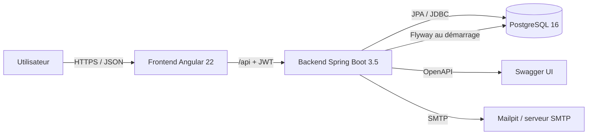
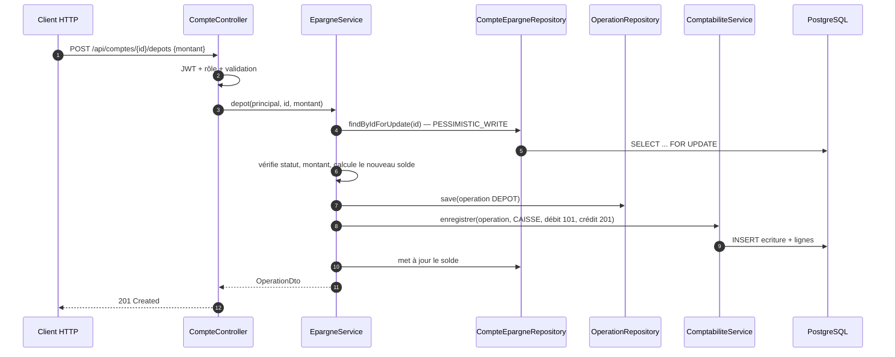
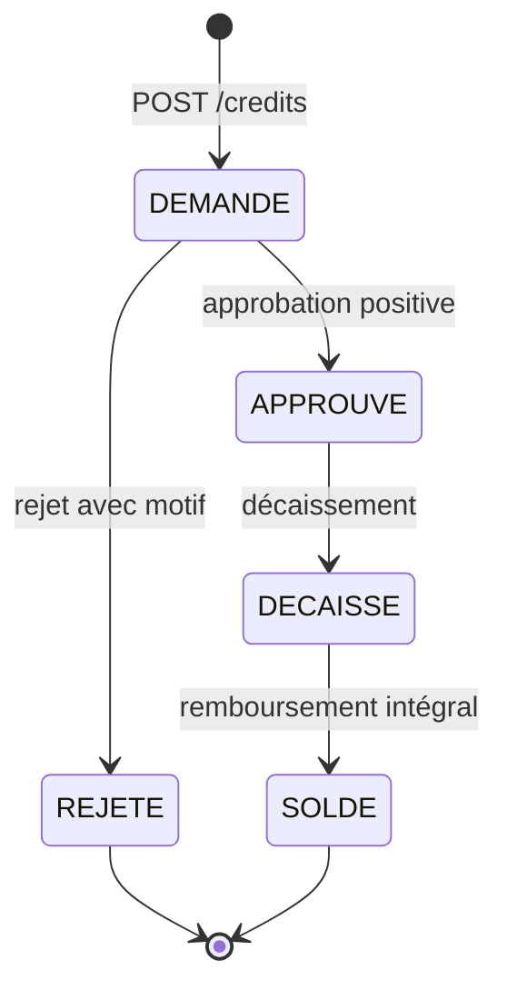
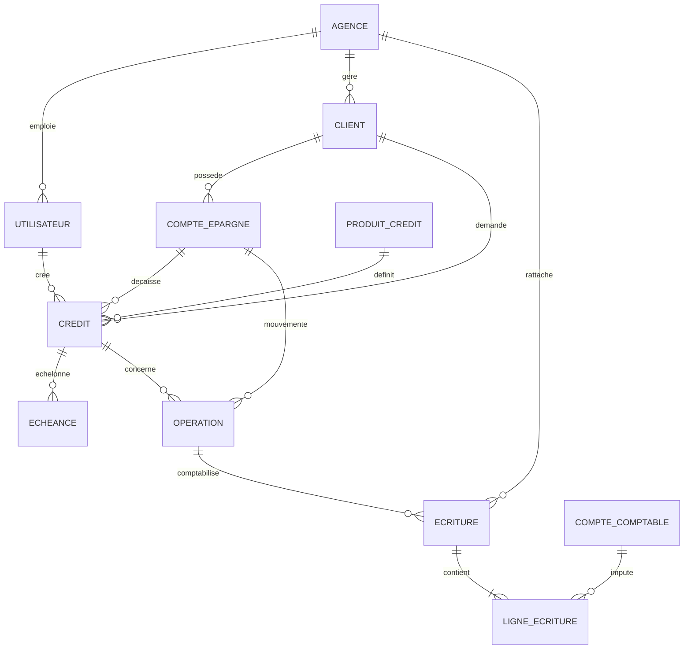
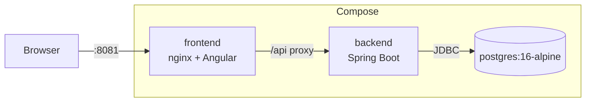

# Architecture — Core Banking SFD Lite

## 1. Vue d'ensemble



L'application est découpée en deux livrables indépendants :

- **backend** : API REST stateless, logique métier, persistance et comptabilité ;
- **frontend** : SPA Angular servie par nginx, qui proxyfie `/api` vers le backend.

En développement, Angular utilise le proxy `proxy.conf.json` vers `http://127.0.0.1:8080`. En production Docker, nginx fait le même travail vers le service `backend`.

## 2. Backend

### 2.1 Couches

```text
controller  →  service  →  repository  →  PostgreSQL
     │             │
     │             └── règles métier, transactions, verrous
     └── validation des DTO, rôles, ProblemDetail
```

- **controller** : routes `/api`, validation Jakarta Bean Validation, `@PreAuthorize`, extraction de `AuthPrincipal`.
- **service** : règles métier (`RG-01` à `RG-14`), orchestration des opérations, transactions et écritures comptables.
- **repository** : Spring Data JPA, requêtes JPQL, verrous pessimistes, séquences natives.
- **DTO** : `record` Java exposés par l'API ; les entités JPA ne sortent jamais des services.
- **common** : sécurité JWT, gestion globale des erreurs, pagination, utilitaires de montants et d'accès agence.

### 2.2 Modules métier

| Module | Responsabilité |
| --- | --- |
| `auth` | Login, refresh, changement de mot de passe, émission des jetons |
| `utilisateur` | Comptes, rôles, rattachement agence, mot de passe temporaire |
| `common.email` | Envoi du mot de passe initial par SMTP ; le message et le mot de passe ne sont jamais journalisés |
| `agence` | Référentiel des agences |
| `client` | Clients, recherche paginée, numérotation |
| `epargne` | Comptes d'épargne, dépôts, retraits, relevés |
| `operation` | Journal des opérations de caisse |
| `credit` | Produits, demandes, approbations, décaissements, échéanciers, remboursements |
| `compta` | Plan comptable, écritures, balance, grand livre, extourne |
| `dashboard` | Agrégats de pilotage |
| `audit` | Traçabilité append-only des connexions et requêtes d'écriture, consultation globale pour `ADMIN` et limitée à l'agence pour `DIRECTEUR` |

### 2.3 Flux d'une opération de caisse



Le solde, l'opération et les écritures sont commités ensemble. Toute exception annule la totalité de la transaction (`RG-13`).

### 2.4 Cycle de vie du crédit



Contrôles principaux :

- montant et durée dans les bornes du produit (`RG-07`) ;
- produit actif, client non bloqué (`RG-06`) ;
- taux copié du produit à la demande (`RG-08`) ;
- approbation/rejet uniquement depuis `DEMANDE` (`RG-09`) ;
- auto-approbation interdite (`RG-10`) ;
- maximum de crédits `DECAISSE` par client (2 par défaut) ;
- décaissement : création de l'échéancier, crédit du compte d'épargne, écriture `301` / `201`, puis frais de dossier `201` / `702`.

### 2.5 Remboursement

1. Verrou pessimiste sur le crédit puis sur le compte d'épargne.
2. Vérification du statut `DECAISSE` et du montant positif.
3. Refus si le montant dépasse le restant dû (`SURPAIEMENT`, `RG-11`).
4. Imputation sur les échéances les plus anciennes, **intérêts avant capital** pour chaque échéance.
5. Mise à jour des statuts `A_PAYER` / `PARTIEL` / `PAYE`.
6. Débit du compte d'épargne, écriture `201` / `301` (capital) et `201` / `701` (intérêts).
7. Passage du crédit à `SOLDE` lorsque tout est payé.

### 2.6 Comptabilité en partie double

`ComptabiliteService` reçoit une opération et une liste de `LigneEcritureCommand`. Avant insertion :

- vérification que la somme des débits égale la somme des crédits, sinon `ECRITURE_DESEQUILIBREE` et rollback (`RG-12`) ;
- génération d'une écriture avec journal (`CAISSE`, `CREDIT`, `OD`), date comptable et lignes ;
- liaison à l'agence et à l'opération.

L'extourne :

- vérifie que l'écriture n'est pas déjà extournée et qu'elle n'est pas elle-même une extourne ;
- crée une écriture inverse avec `extourne_de` renseigné ;
- utilise la date du jour ;
- ne modifie jamais l'écriture d'origine (`RG-14`).

La table `ligne_ecriture` est protégée par des triggers PostgreSQL (`V2__immutabilite_index.sql`) qui rejettent `UPDATE` et `DELETE`.

### 2.7 Sécurité

```mermaid
flowchart TD
    A[Requête HTTP] --> B{JWT présent ?}
    B -- non --> E[401 NON_AUTHENTIFIE]
    B -- oui --> C[Validation signature + expiration]
    C -- invalide --> E
    C -- valide --> D[AuthPrincipal: id, rôle, agenceId, flag mot de passe]
    D --> D2{Mot de passe temporaire ?}
    D2 -- oui --> L[403 sauf changement de mot de passe]
    D2 -- non --> F{@PreAuthorize}
    F -- refus --> G[403 ACCES_REFUSE]
    F -- accord --> H[Service]
    H --> I{AccesAgence.verifier}
    I -- hors agence --> J[404 ressource introuvable]
    I -- autorisé --> K[Traitement]
```

- JWT signé HS512, access token 15 minutes, refresh token 7 jours, claims `sub`, `role`, `agenceId`, `doitChangerMotDePasse`, `type`.
- Mots de passe BCrypt. À la création d'un utilisateur, l'administrateur ne saisit pas de mot de passe : le backend génère un secret temporaire, envoie un e-mail (Spring Mail/SMTP) et positionne le flag de premier login.
- Le filtre `MotDePasseTemporaireFilter` bloque les API tant que le mot de passe n'a pas été changé. `POST /api/auth/mot-de-passe` vérifie le mot de passe temporaire et renvoie de nouveaux jetons avec le flag à `false`.
- `ADMIN` et `DIRECTEUR` sont globaux (`estGlobal`) : ils peuvent cibler une agence ou voir le consolidé.
- Les autres rôles sont **contraints à l'agence du JWT** ; un paramètre `agenceId` fourni par le client est ignoré ou rejeté.
- Une ressource d'une autre agence renvoie **404** plutôt que 403 pour ne pas révéler son existence.
- Les erreurs sont normalisées en `ProblemDetail` RFC 7807 avec `code` stable.

### 2.8 Transactions et concurrence

- Toutes les opérations métier sont `@Transactional`.
- Les soldes de comptes et les crédits à modifier sont chargés avec `@Lock(PESSIMISTIC_WRITE)` (`SELECT ... FOR UPDATE`).
- Les références sont générées par des séquences PostgreSQL :
  - `CL-AG001-000001` (client) ;
  - `EP-AG001-000001` (compte d'épargne) ;
  - `CR-AG001-000001` (crédit) ;
  - `OP-YYYYMMDD-000001` (opération).
- Le test d'intégration `ConcurrenceRetraitIntegrationTest` vérifie que 30 retraits concurrents de 1 000 sur un solde de 10 000 donnent exactement 10 succès et un solde final nul.

### 2.9 Modèle de données



Contraintes structurantes :

- montants en `NUMERIC(18,0)` (FCFA entiers) ;
- dates métier en `DATE`, horodatages en `TIMESTAMPTZ` UTC ;
- `client.sexe` et `ligne_ecriture.sens` en `CHAR(1)` avec `@JdbcTypeCode(SqlTypes.CHAR)` pour rester compatibles avec `ddl-auto=validate` ;
- index sur les recherches fréquentes (agence, client, dates, statuts) ;
- triggers d'immuabilité sur les lignes d'écriture.

### 2.10 Migrations Flyway

| Version | Contenu |
| --- | --- |
| `V1__init.sql` | Schéma complet, clés étrangères, contraintes |
| `V2__immutabilite_index.sql` | Triggers d'immuabilité, index, séquences |
| `V3__seed.sql` | 2 agences, 5 utilisateurs, 5 comptes comptables, 3 produits |
| `V4__mot_de_passe_premier_login.sql` | Flag `doit_changer_mot_de_passe` sur les utilisateurs |

`spring.jpa.hibernate.ddl-auto=validate` garantit que le schéma Flyway et les entités restent alignés.

## 3. Frontend

### 3.1 Organisation

```text
src/app/
├── core/
│   ├── models.ts          # types partagés
│   ├── auth.service.ts    # session, jetons, rôles
│   ├── auth.interceptor.ts# Bearer + refresh sur 401
│   ├── guards.ts          # authGuard, roleGuard
│   ├── fcfa.pipe.ts       # formatage FCFA
│   ├── error.util.ts      # lecture du ProblemDetail
│   └── services/          # ClientApi, EpargneApi, CreditApi, ComptaApi, AdminApi, DashboardApi
├── layout/shell.ts        # barre latérale filtrée par rôle, responsive
├── pages/                 # écrans lazy-loaded
└── shared/                # modules Material, dialogues, graphiques SVG
```

Le shell utilise `BreakpointObserver` : au-dessous de 900 px, la barre latérale passe en mode `over` et se referme après navigation. Les tableaux sont enveloppés dans `.table-scroll` et les grilles de formulaires passent sur une colonne sur mobile.

### 3.2 Graphiques de pilotage

Le tableau de bord agrège côté backend les données nécessaires aux décisions :

- flux mensuels sur 6 mois : collecte (dépôts), décaissements, remboursements ;
- répartition des crédits par statut (`DEMANDE`, `APPROUVE`, `DECAISSE`, `SOLDE`, `REJETE`) ;
- échéances en retard et montant impayé ;
- encours d'épargne, de crédit et comptes actifs par agence.

Les composants `BarChart` et `DonutChart` sont autonomes et dessinent en SVG, sans bibliothèque de graphiques externe. La jauge de couverture et les barres par agence utilisent du CSS. Toutes les valeurs monétaires restent en `BigDecimal` côté backend et sont formatées en FCFA côté Angular.

### 3.3 Navigation et rôles

- `authGuard` protège l'espace applicatif ; sans jeton, redirection vers `/login`.
- `premierLoginGuard` redirige vers `/mot-de-passe` tant que le mot de passe temporaire n'a pas été remplacé.
- `roleGuard([...])` protège les routes `caisse`, `credits/nouveau`, `approbations`, `comptabilite` et `admin`.
- `/mon-compte` n'est soumis à aucun `roleGuard` : tous les utilisateurs authentifiés peuvent consulter leur profil et changer leur mot de passe. La page lit les informations de session exposées par `AuthService.utilisateur()` et réutilise `POST /api/auth/mot-de-passe`.
- Le menu du shell n'affiche que les entrées autorisées pour le rôle courant.
- L'interceptor ajoute `Authorization: Bearer <accessToken>` ; sur `401`, il tente un `refresh` puis rejoue la requête une fois. En cas d'échec, la session est vidée et l'utilisateur revient à la connexion.

### 3.4 Écrans

| Route | Écran |
| --- | --- |
| `/login` | Connexion |
| `/mot-de-passe` | Changement obligatoire du mot de passe temporaire |
| `/dashboard` | Indicateurs, graphiques de pilotage et accès rapides |
| `/mon-compte` | Informations du compte et changement volontaire du mot de passe |
| `/clients` | Liste, recherche, création |
| `/clients/:id` | Fiche client, comptes, crédits |
| `/caisse` | Dépôt / retrait avec confirmation et relevé |
| `/credits` | Liste et filtres par statut |
| `/credits/nouveau` | Demande de crédit |
| `/credits/:id` | Détail, échéancier, remboursement |
| `/approbations` | File d'approbation |
| `/comptabilite` | Balance, grand livre, détail d'écriture, extourne, export CSV |
| `/admin` | Agences, utilisateurs, produits, plan comptable |

### 3.5 Formatage monétaire

Le pipe `fcfa` formate les montants avec le séparateur de milliers français et le suffixe `FCFA` (ex. `1 250 000 FCFA`). Les calculs restent en nombres entiers côté API ; le frontend ne réalise aucun calcul de solde critique.

## 4. Déploiement Docker



- `postgres` : volume nommé `pgdata`, healthcheck `pg_isready`.
- `backend` : build multi-stage Maven → JRE 21 Alpine, utilisateur non-root, healthcheck sur `/v3/api-docs`.
- `frontend` : build multi-stage Node 22 → nginx, fallback SPA, cache des assets, proxy `/api`.
- `frontend` ne démarre qu'après le healthcheck du backend ; le backend attend PostgreSQL.

Les secrets et ports sont paramétrables dans `.env` (voir `.env.example`).
